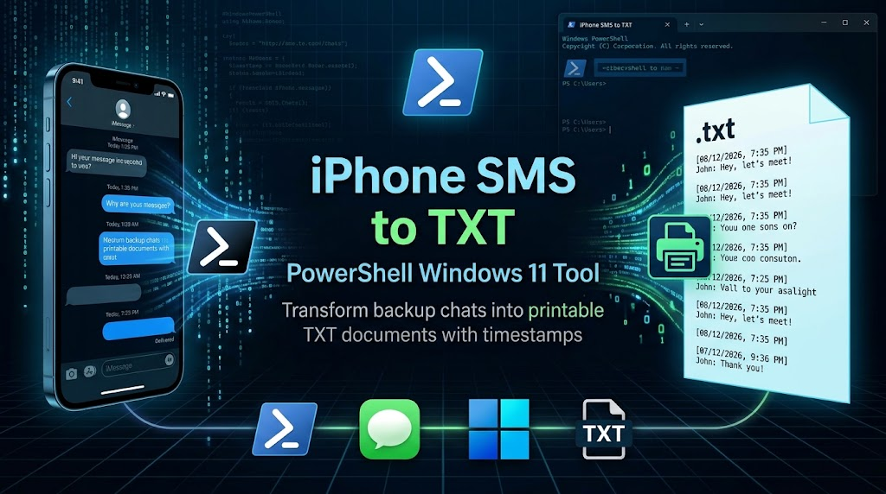

# iPhone conversation → printable text (Windows 11)

Exports one iPhone text conversation (SMS, MMS and iMessage) to a `.txt` file. Each message shows its date and time, the sender and the text.

The actual extraction is done by [imessage-exporter](https://github.com/ReagentX/imessage-exporter) by ReagentX (GPL-3.0). This repo is a Windows wrapper around it: the script downloads release 4.3.0 on first run, checks it against a pinned SHA256, finds the iPhone backup and runs the export.

## 1. Back up the iPhone

1. Install **Apple Devices** from the Microsoft Store. Recent iTunes also works.
2. Connect the iPhone by cable, unlock it, and tap **Trust** when asked.
3. In Apple Devices, select the iPhone. Under **Backups**, choose the option to back up all data to this computer (not iCloud), then click **Back Up Now**. Wait for it to finish.
   - An encrypted backup also works. You'll be asked for the backup password during export.

## 2. Export the conversation

Copy this folder to the PC. Open PowerShell in it and run:

```powershell
powershell -ExecutionPolicy Bypass -File .\Export-Conversation.ps1 -Contact 5558675309
```

`-Contact` accepts a phone number (digits only), an email address, or a contact name. A name works only if Contacts is in the backup. Optional parameters:

| Parameter | Purpose |
|---|---|
| `-StartDate 2026-01-01` | Only messages on or after this date |
| `-EndDate 2026-07-01` | Only messages before this date |
| `-BackupPath <dir>` | Use a specific backup. The default is the newest one found. |
| `-OutDir <dir>` | Output folder. The default is `export-<timestamp>` next to the script. |

Three "No HEIC/CAF/MOV converter found" warnings appear on every run; they only affect attachments and can be ignored. The script prints the paths of the exported `.txt` files. Every conversation that includes the contact is exported, group chats included, so pick the file you need.

Example output:

```text
Feb 06, 2025  1:25:24 PM (Read by you after 2 minutes, 40 seconds)
Jane Doe
I'm going to try to eat as quick as possible and then come over

Feb 06, 2025  1:31:02 PM
Me
Sounds good, see you soon
```

## 3. Print

Open the `.txt` file in Notepad and choose **File → Print**.

## Limitations

- If **Messages in iCloud** is on, messages not stored on the phone itself are missing from the backup. iCloud Backup doesn't include them either. To get the full history onto the phone before step 1:
  1. On the iPhone, open **Settings → [your name] → iCloud → Messages in iCloud**. On some iOS versions it's under **Saved to iCloud**. Turn off **Use on this iPhone**.
  2. When prompted, choose **Disable and Download Messages**. The phone needs enough free storage, and a large history can take a while.
  3. When the download finishes, continue from step 1 above. You can turn Messages in iCloud back on after the export.

  Do **not** choose **Disable & Delete** (or **Turn Off and Delete from iCloud**). That turns the feature off on every device and deletes the iCloud copy. Menu names can vary slightly between iOS versions.
- Attachments appear as file references, not images.
- Without Contacts in the backup, senders show as phone numbers or email addresses.

## License

MIT, see [LICENSE](LICENSE). imessage-exporter is a separate project under GPL-3.0; it is downloaded at run time, not included in this repo.
